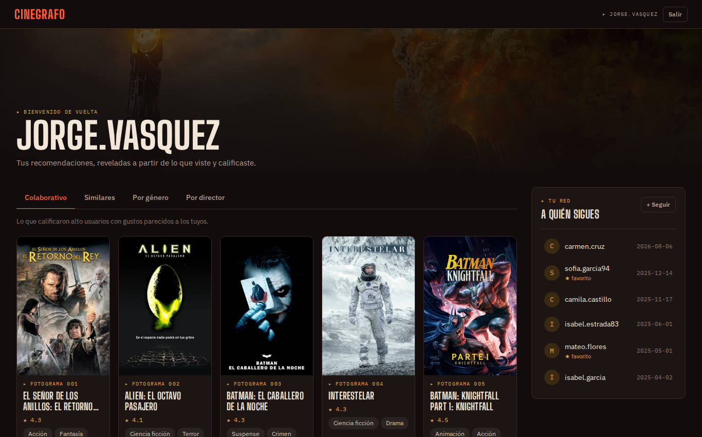
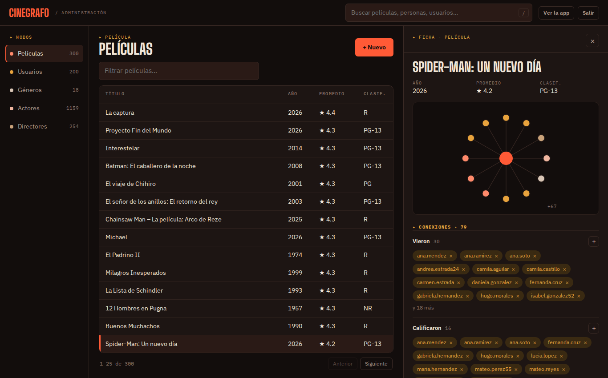
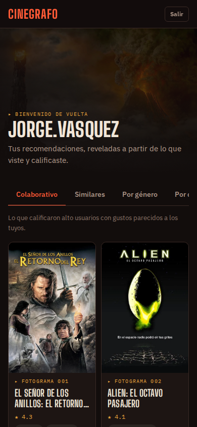
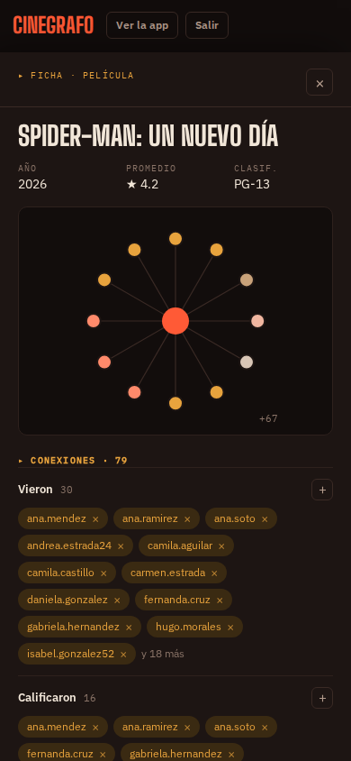

# Recomendador de películas: web

> Frontend en Vue del recomendador de películas basado en grafos



Interfaz del recomendador. La API, el modelo de grafo y las estrategias de recomendación están documentados en [movie-recommender-api](https://github.com/DiegoOF07/movie-recommender-api).

## Qué hace

- **Panel de usuario:**
  - recomendaciones con cada una de las cuatro estrategias: colaborativa, películas similares, por género y por director;
  - marcar películas como vistas y calificarlas con medias estrellas (de 0.5 a 5). Todo se guarda en el grafo, así que cambia las recomendaciones;
  - un catálogo con filtros y la lista de usuarios que sigues.
- **Panel de administración:**
  - lista de nodos por tipo y una ficha con sus datos;
  - un mini grafo de vecinos, por el que se puede navegar de nodo en nodo;
  - las conexiones agrupadas por relación;
  - agregar conexiones buscando el otro nodo por nombre, sin escribir claves exactas;
  - buscador global (tecla `/`), edición de propiedades y borrado con el conteo de conexiones afectadas.



## Diseño

La identidad se llama **Revelado**: el cuarto oscuro donde se revela la película.

- **Colores:** negro cálido (`#120d0c`), la luz roja de seguridad (`#ff5a36`) para las acciones y el ámbar (`#e8a33d`) para calificaciones y etiquetas.
- **Metadatos:** en IBM Plex Mono, como los códigos impresos en el borde del celuloide. Los títulos van en Big Shoulders Display.
- **Tipos de nodo:** cada uno tiene su color (película, usuario, género, actor, director) y lo conserva en chips, en la tabla y en el mini grafo.

Los componentes base (botón, chip, tabla, autocompletar, diálogo, calificación y mini grafo) están en `src/ui/`, escritos sin librerías de componentes. El autocompletar sigue el patrón combobox de WAI-ARIA, y la calificación es un `slider` accesible con teclado.

| Teléfono | Ficha en teléfono |
|---|---|
|  |  |

## Stack

Vue 3 · TypeScript · Vite · Vue Router · Vitest

## Cómo correrlo

Con la [API](https://github.com/DiegoOF07/movie-recommender-api) corriendo y sus datos de muestra cargados:

```bash
npm install
npm run dev      # http://localhost:5173
npm test         # pruebas de componentes, store y cliente de la API
```

Para entrar, usa cualquier usuario de los datos de muestra, por ejemplo `jorge.vasquez`.

Variables opcionales en `.env`:

| Variable | Por defecto | Uso |
|---|---|---|
| `VITE_API_BASE_URL` | `http://localhost:8080` | URL de la API |
| `VITE_ADMIN_PASSWORD` | `admin1234` | contraseña del panel de administración (solo demo: se valida en el navegador) |

## Equipo

Proyecto del curso Bases de Datos 2, UVG, 2026: Diego Flores ([@DiegoOF07](https://github.com/DiegoOF07)), Juan Solis ([@JuanDsm04](https://github.com/JuanDsm04)) y Víctor Pérez ([@vicperezch](https://github.com/vicperezch)). Los tres trabajamos en todas las capas.

El rediseño "Revelado" y el panel de administración actual son posteriores al curso.
